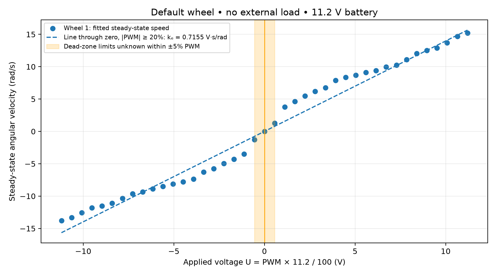
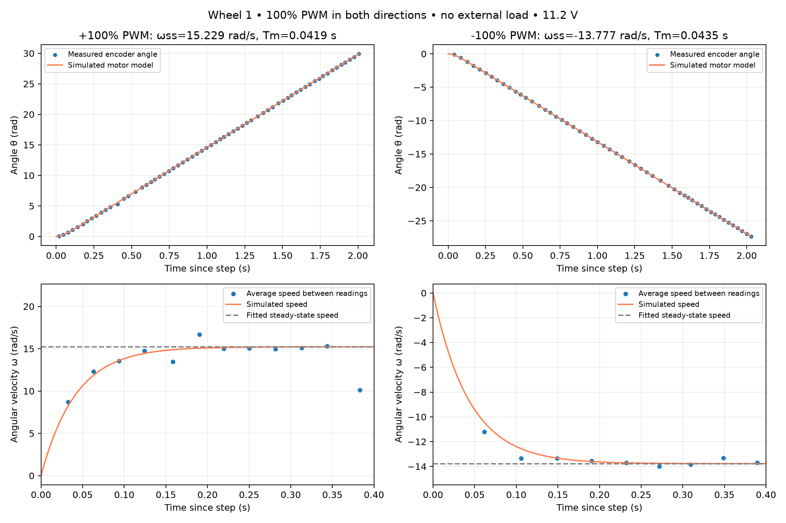

# Lab 5 — DC motor identification

## Motor parameters

I tested one default wheel without load; no second-wheel measurements are available. At 0% PWM, T_m cannot be determined because the wheel did not move.

| PWM (%) | Wheel 1 T_m (s) | Wheel 1 ω_ss (rad/s) |
|---:|---:|---:|
| -100 | **0.0435** | -13.7768 |
| -95 | **0.0677** | -13.3303 |
| -90 | **0.0731** | -12.5399 |
| -85 | **0.0836** | -11.8155 |
| -80 | **0.1100** | -11.5077 |
| -75 | **0.1258** | -11.0926 |
| -70 | **0.1432** | -10.3378 |
| -65 | **0.1713** | -9.6250 |
| -60 | **0.1676** | -9.3396 |
| -55 | **0.2050** | -8.8527 |
| -50 | **0.1930** | -8.4879 |
| -45 | **0.2080** | -8.1137 |
| -40 | **0.2078** | -7.7769 |
| -35 | **0.2223** | -7.3778 |
| -30 | **0.2403** | -6.2951 |
| -25 | **0.2783** | -5.7365 |
| -20 | **0.2911** | -4.9688 |
| -15 | **0.2902** | -4.3034 |
| -10 | **0.2857** | -3.4786 |
| -5 | **0.1875** | -1.2527 |
| 0 | **N/A** | 0.0000 |
| 5 | **0.2218** | 1.2577 |
| 10 | **0.3263** | 3.7726 |
| 15 | **0.2859** | 4.6407 |
| 20 | **0.2991** | 5.4906 |
| 25 | **0.2879** | 6.2021 |
| 30 | **0.2458** | 6.7612 |
| 35 | **0.2238** | 7.8997 |
| 40 | **0.2077** | 8.3571 |
| 45 | **0.1933** | 8.6677 |
| 50 | **0.1994** | 9.1027 |
| 55 | **0.1858** | 9.4113 |
| 60 | **0.1648** | 9.9746 |
| 65 | **0.1582** | 10.2566 |
| 70 | **0.0958** | 11.1225 |
| 75 | **0.1328** | 12.0486 |
| 80 | **0.1059** | 12.5118 |
| 85 | **0.1010** | 12.8993 |
| 90 | **0.0721** | 13.7100 |
| 95 | **0.0602** | 14.6708 |
| 100 | **0.0419** | 15.2292 |

## Speed against voltage

> **Identified k_e = 0.71550 V·s/rad** (fit across |PWM| ≥ 20%).

I calculated U = 11.2 × PWM/100 V from the measured battery voltage and fitted ω_ss = U/k_e. The shaded region (−0.56 to +0.56 V) brackets the unresolved dead zone: the wheel already moved at ±5% PWM.

## Step responses at ±100% PWM

> **Identified T_m: 0.04186 s at +100% PWM; 0.04346 s at −100% PWM.**

## Discussion

The linear speed–voltage model fits poorly at intermediate PWM, and T_m changes with PWM, so one fixed model does not describe the full range. Friction near zero and the extra load when driving on the floor also limit the model. I cannot quantify the difference between the two wheels because I only measured one. If their speeds differ at equal PWM, the robot will curve, and assuming equal speeds in next week's odometry will cause heading and position errors. Using each wheel's encoder readings accounts for this speed difference, although wheel-size errors and slip will still affect odometry.
