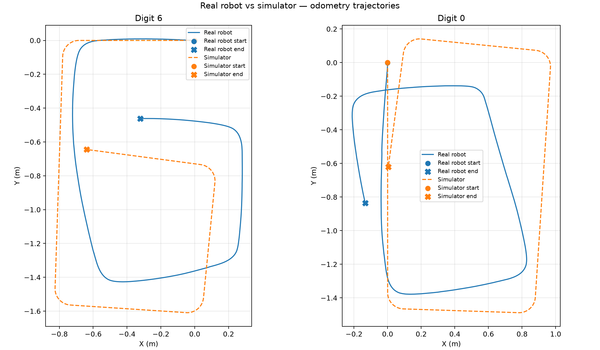
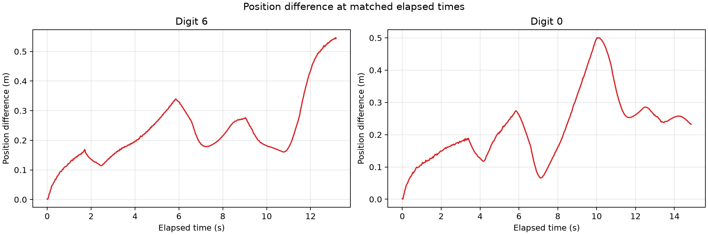

# Lab 6 — Differential-drive localization

## Aim and method

Compare the real robot's encoder-based odometry with simulator odometry for the digit-6 and digit-0 trajectories. The saved TRIK Studio project is [Localization_demo.qrs](Localization_demo.qrs). The original analysis is in [analysis.py](analysis.py), and the printed results are in [comparison_summary.txt](comparison_summary.txt).

The saved diagram uses wheel radius `r = 0.042 m`, axle separation `B = 0.194 m`, left encoder E4 and right encoder E3. Encoder angles are converted from degrees to radians. The accumulated distance and heading are calculated as `s = r(θR + θL)/2` and `θ = r(θR − θL)/B`; each position update adds `Δs cos(θ)` to x and `Δs sin(θ)` to y. Logs contain three comma-separated columns: **x (m), y (m), timestamp (ms)**.

Each run's clock is reset to its first logged sample. The simulator coordinates are linearly interpolated onto real timestamps within the common duration, including its exact endpoint, without extrapolation. The position difference is `sqrt((x_real − x_sim)² + (y_real − y_sim)²)`, and RMSE is the square root of the mean squared difference over those comparison samples. The original plots rotate both paths equally for display; errors are computed in the recorded frame and are unaffected by these rotations. Separate clock origins provide approximate synchronization, so the comparison includes speed and timing differences.

## Raw logs

| Trajectory | Real robot | Simulator |
|---|---|---|
| Digit 6 | [nav_data_6.csv](data/nav_data_6.csv) | [nav_data_6_sim.csv](data/nav_data_6_sim.csv) |
| Digit 0 | [nav_data_0.csv](data/nav_data_0.csv) | [nav_data_0_sim.csv](data/nav_data_0_sim.csv) |

All four original logs and the original code are preserved without modification.

## Results

| Quantity | Digit 6 | Digit 0 |
|---|---:|---:|
| Real / simulator sample count | 461 / 1,317 | 444 / 1,487 |
| Real / simulator duration (s) | 13.721 / 13.160 | 15.818 / 14.860 |
| Real / simulator odometry path length (m) | 4.195 / 4.701 | 4.661 / 5.390 |
| Mean matched-time position difference (m) | 0.232 | 0.223 |
| Position RMSE (m) | 0.258 | 0.247 |
| Maximum position difference (m) | 0.547 | 0.501 |
| Position difference at overlap end (m) | 0.544 | 0.232 |
| Separation of final logged positions (m) | 0.365 | 0.256 |

The final-position separation compares runs with different finish times and is distinct from the matched-time error. Simulator odometry is a reference estimate, not independently measured ground truth.

### Trajectory comparison



### Position difference over time



## Endpoint

The final line of the digit-6 real log is:

```text
0.3220413248560163,0.4615452497956325,14321
```

This gives a final logged estimate of **(0.322041 m, 0.461545 m)** at timestamp **14321 ms**. The digit-0 real log ends at **(0.836512 m, −0.132597 m)** at **16581 ms**. These coordinates use the recorded odometry frame, before the display rotations. The logger ends after the movement sequence, so its last line is not guaranteed to include motion during final mechanical settling. No tape measurement was supplied; the physical endpoint comparison is omitted as requested, and no physical localization error is claimed.

## Discussion (5 sentences)

The real-robot odometry for digit 6 shows a shorter overall path than the simulator, with visible divergence along the long straight segment and the final segment after the turns.
For digit 0, the real path is also shorter and its final logged position differs from the simulator by 0.256 m, while digit 6 finishes 0.365 m away.
These differences compare odometry estimates and include timing effects, so they do not establish the robot's physical localization error.
Wheel slip, unequal effective wheel radii, and unmodeled friction are plausible sources because they violate the lecture's pure-rolling and identical-wheel assumptions, although these logs cannot identify the dominant cause.
The robot does not know its absolute position is wrong from wheel encoders alone because it integrates the same imperfect motion measurements and needs an independent position observation to detect or correct drift.
