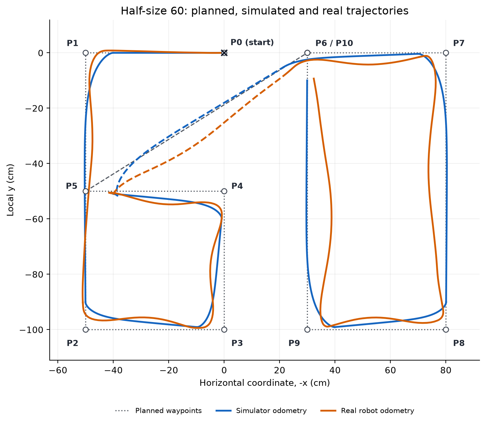
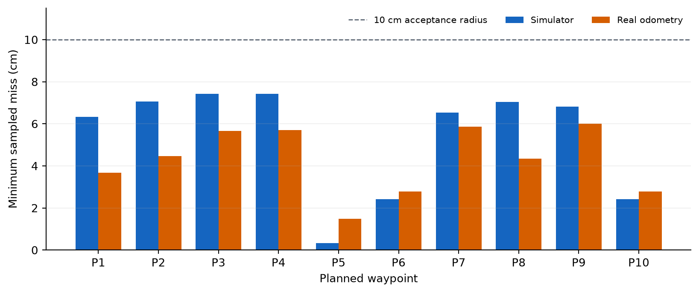
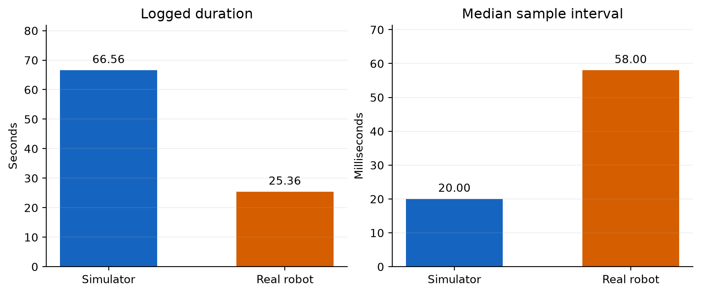

# Lab 7 - Go-to-goal control: 60

**CS413 Robotics · Student ID suffix: 60 · 27 October 2026**

## Aim

Use continuous go-to-goal (GTG) control to follow the last two student-ID digits, then compare the planned path, simulator trajectory and real-robot odometry. The physical experiment uses waypoint coordinates **half the size of the original plan**: each digit is 50 cm wide and 100 cm high, separated by 30 cm.

The real log was retrieved from the robot's default scripts folder. A **new matched simulator run** was generated from the supplied real program. It uses the same half-size goals, gains, power limit, acceptance radius and requested wait; only robot geometry, output filename and descriptive comment differ. The earlier full-size simulator run is excluded rather than rescaled to appear comparable. No real data were fabricated, resampled, time-aligned or spatially fitted.

## Files to review

- [Executed Colab notebook](Lab7_Go_to_goal_analysis.ipynb): trajectory overlay, waypoint-miss table, logged durations, sampling comparison and discussion. In Colab, upload the two TXT files and run all cells.
- [Simulator program](go_to_goal_sim.qrs) and [real-robot program](go_to_goal_real.qrs).
- [Simulator odometry](odometry_data_sim.txt) and [real odometry](odometry_data_real.txt): **no header**, exactly `x_cm,y_cm,time_ms`.
- [Original nine-column logs and provenance](data/), [numerical results](data/analysis_results.json), and [waypoint-miss CSV](data/waypoint_miss.csv).

## Controller and parameters

With distance `d` in metres and heading error `e` in radians:

```text
e     = atan2(sin(course - theta), cos(course - theta))
V     = K_dist * d * cos(e)
omega = K_angle * e + K_dist * sin(e) * cos(e)
left  = 200 * (V + W*omega/2)
right = 200 * (V - W*omega/2)
```

Both wheel commands are scaled by the same factor if either exceeds the power limit. The program computes position by midpoint-heading encoder odometry, switches goals inside the acceptance radius, and buffers samples in memory before writing each completed goal's log.

| Parameter | Matched simulator | Real program |
|---|---:|---:|
| `K_dist` | 0.6 | 0.6 |
| `K_angle` | 5.0 | 5.0 |
| Maximum motor power | 70% | 70% |
| Acceptance radius | 10 cm | 10 cm |
| Requested control wait | 20 ms | 20 ms |
| Wheel radius used in odometry | 2.8 cm | 4.2 cm |
| Wheel separation used in odometry | 15.4 cm | 19.4 cm |
| Left motor / encoder | M3 / E3 | M3 / E3 |
| Right motor / encoder | M4 / E4 | M4 / E4 |

The real program's active heading gain is 5, even though an old comment still mentions 30. The geometry values above are those programmed into odometry; this report does not claim an independent wheel-dimension measurement.

## Planned path and trajectory comparison

The initial point is `(0,0)`. Local x follows the initial heading, and positive local y points to the robot's initial right.

```text
6:        (50,0), (50,-100), (0,-100), (0,-50), (50,-50)
Transfer: (-30,0)
0:        (-80,0), (-80,-100), (-30,-100), (-30,0)
```

All coordinates above are in centimetres. The plot reflects x consistently for the plan and both logs so that 60 appears upright. This common reflection preserves distances. Dashed segments show transfer goal index 5; this is a plotting convention and does not imply that a physical pen was lifted.



Point labels P0-P10 match the waypoint-miss table below. P6 and P10 share the same coordinates and are shown together as **P6 / P10**.

## Waypoint-miss table

The course definition is the minimum sampled distance to each waypoint over the **whole run**:

```text
miss(P) = min over samples sqrt((x-Px)^2 + (y-Py)^2)
```

| Point | x (cm) | y (cm) | Simulator miss (cm) | Real odometry miss (cm) |
|---|---:|---:|---:|---:|
| P0 (start) | 0 | 0 | 0.000 | 0.000 |
| P1 | 50 | 0 | 6.331 | 3.675 |
| P2 | 50 | -100 | 7.050 | 4.465 |
| P3 | 0 | -100 | 7.431 | 5.657 |
| P4 | 0 | -50 | 7.429 | 5.699 |
| P5 | 50 | -50 | 0.334 | 1.477 |
| P6 (transfer) | -30 | 0 | 2.414 | 2.783 |
| P7 | -80 | 0 | 6.527 | 5.857 |
| P8 | -80 | -100 | 7.036 | 4.344 |
| P9 | -30 | -100 | 6.808 | 6.002 |
| P10 (close 0) | -30 | 0 | 2.414 | 2.783 |

P6 and P10 are the same coordinates, so their whole-run minimum distances are identical. A later segment may also pass closer to a waypoint than the arrival sample that triggered the switch. The notebook therefore provides an additional **active-goal miss** using only samples recorded while that goal was active. Both runs reached all ten goals within the 10 cm tolerance; active-goal arrival misses ranged from 9.932 to 9.991 cm in simulation and 9.541 to 9.854 cm in the real log.



## Logged run times and sampling

Duration follows the course calculation `(last_timestamp - first_timestamp) / 1000`. Original timestamps are retained: the simulator log begins at 0 ms, and the real log at 25 ms. Logged duration excludes unrecorded initialization and the final stop/write interval.

| Metric | Simulator | Real robot |
|---|---:|---:|
| Samples | 3,329 | 430 |
| Logged duration | 66.560 s | 25.363 s |
| Odometry path length | 616.73 cm | 632.72 cm |
| Median sampling interval | 20.0 ms | 58.0 ms |
| Mean sampling interval | 20.00 ms | 59.12 ms |
| 95th-percentile sampling interval | 20.0 ms | 68.0 ms |
| Maximum sampling interval | 20.0 ms | 91.0 ms |



The simulator's logged duration was 2.62 times the real run's duration. Equal gains and motor-power percentages do not calibrate the two platforms to equal physical velocities. The requested 20 ms wait is also not a guaranteed real sampling period: computation and runtime delays contribute to the observed 58 ms median. No unbuffered physical baseline is available, so the improvement caused by buffering cannot be quantified from this experiment alone.

## Discussion - five sentences

Both estimated trajectories round the bottom corners of the 6 (P2-P3) and 0 (P8-P9), with the largest global miss at P3 for the simulator (7.43 cm) and P9 for the real log (6.00 cm). The 10 cm acceptance radius is 20% of a digit's width and allows switching before the exact corner, while the heading gain of 5 permits simultaneous translation and turning. Active-goal arrival misses of 9.93-9.99 cm in simulation and 9.54-9.85 cm on the robot are consistent with tolerance-based switching rather than exact waypoint arrival. The robot's logged duration of 25.363 s versus 66.560 s in simulation is compatible with different motor-speed responses to the same nominal commands and does not establish better tracking. The remaining real/model gap may combine motor response, wheel slip and odometry drift; encoder-only data cannot separate physical control error from localization error.

## Data provenance and limitations

The original nine-column logs are preserved unchanged in `data/`. For the required TXT exports, every row is retained, x/y are multiplied by 100 to convert metres to centimetres, and the recorded millisecond timestamp is copied unchanged. There is no header, no extra diagnostic column and no additional halving of the measured coordinates. File hashes and export details are recorded in [provenance.json](data/provenance.json).

The primary comparison uses the robot's own encoder position estimate. A smaller waypoint miss in the real log does **not** establish better physical accuracy. This report covers the trajectory, waypoint-miss and run-time analysis; it makes no independent physical-endpoint accuracy claim.

Reference: [NewUU Robotics course - Lab 7 instructions](https://github.com/NewUU-engineering/Robotics-course/blob/main/07_Go-to-goal/README.md).
